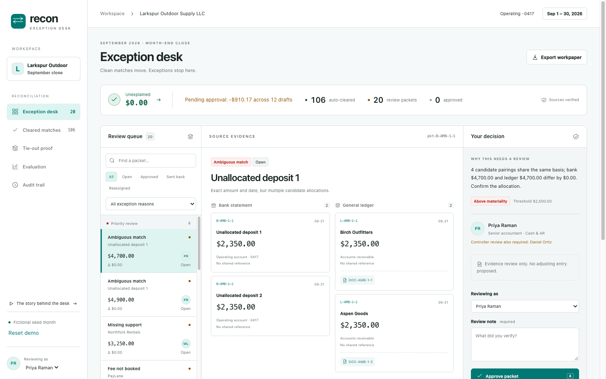
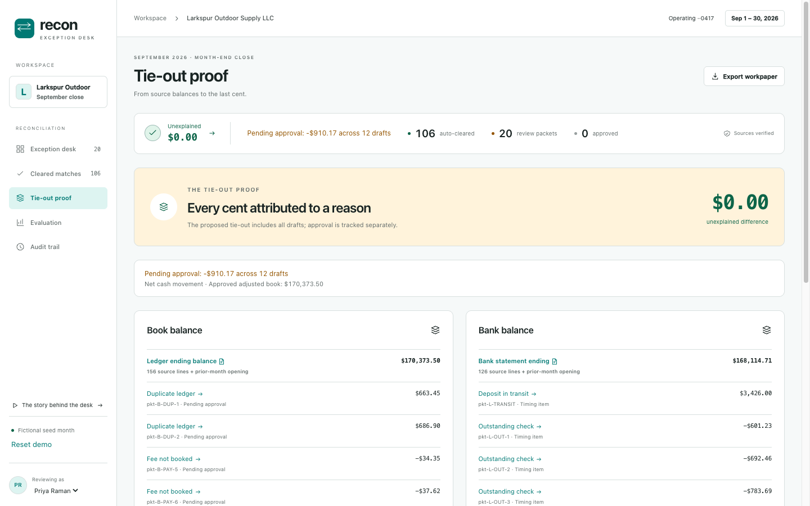
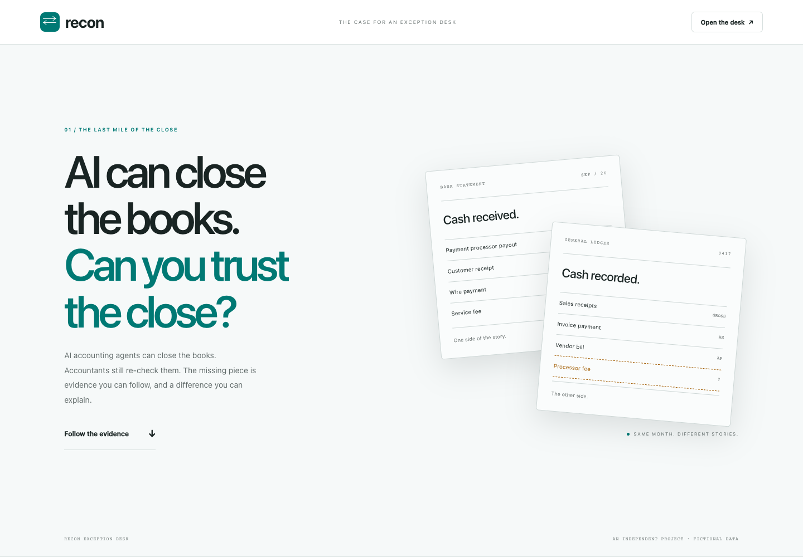

# Recon Exception Desk

A bank reconciliation desk where clean matches move, exceptions stop, and the tie-out proves it.

An independent project for **bank reconciliation review for AI accounting agents**. All people, transactions and documents in the demo are fictional; clients and counterparties use neutral labels.

## Context and the feature

AI accounting agents can prepare the books, but accounting firms and controllers still reconstruct reconciliations when the output is only a list of unmatched items. Trust requires a supported relationship, an explanation for every exception, a named reviewer and a balance that ties to the cent.

This desk matches a bank statement against a general-ledger cash account. It clears supported, unambiguous relationships and packages the remaining work with both sides of the evidence, candidate pairings, a reason, materiality, an owner and a balanced draft entry where appropriate. The tie-out and labelled evaluation make the result inspectable.

It was chosen over a missing-document verifier because document chasing is already common, and document verification would require extraction that this demo cannot honestly demonstrate. Reconciliation decisions can be deterministic and tested against real accounting relationships using fictional source data.

## Screenshots







## Run locally

Use Node.js **20.19+ or 22.12+** and npm.

```sh
npm install
npm run dev
```

Open **http://localhost:4610** for the desk and **http://localhost:4610/story** for the explainer. No keys, accounts, network integrations or database are needed. Runtime requests stay on the local origin.

```sh
# Production
npm run build
npm start

# Optional host/port overrides
PORT=4611 HOST=127.0.0.1 npm run dev
```

`.env.example` documents the two optional variables. The server reads process environment variables; it does not automatically load `.env` files. State is in memory and resets on restart. **Reset demo** or `POST /api/reset` restores the source fixture and clears review history.

## Using the desk

- Filter the queue by reason, status or text. Priority groups separate judgment from period-end timing.
- Click a source or document ID to inspect its fictional evidence record. A document here is a seeded metadata record, not an extracted PDF.
- Add a review note, then approve, send back or reassign. Choose the actor using **Reviewing as**. Above-materiality packets require both the routed reviewer and the controller before their status becomes approved. Sending back or reassigning clears prior approvals. Actors must resolve to a registered reviewer by ID or exact name; only a packet’s required reviewers can approve it.
- Press `j` / `k` to navigate, `a` to approve, or `s` to send back. Shortcuts do not run while typing or while a dialog is open. A note is always required.
- Reopen a cleared match to create a `MANUAL_REVIEW` packet with the original evidence and matching basis.
- Export the Markdown workpaper for the tie-out, packets, source IDs, reviewer statuses, approved draft entries and audit history.

**Approving never posts. Entries stay drafts until exported. Exporting does not post them either.** The proposed tie-out includes all suggested adjustments, including open or sent-back drafts; it is explicitly not a posted cash balance. Unexplained means the difference not attributed to any packet. Pending approval shows the signed net cash movement and count of unapproved drafts, including Suspense. Approved adjusted book uses approved drafts only. These totals refresh after decisions, reopening and reset; the workpaper separates pending and approved adjustments.

Routes: `/#/desk`, `/#/matches`, `/#/tieout`, `/#/eval`, `/#/audit`, and `/story`.

## Matching and confidence

`reconcile(input)` is pure and returns `{ matches, packets, tieOut, stats }`. Source amounts and all accounting calculations are signed integer cents. Positive movement increases cash; negative movement decreases it. Dates are ISO `YYYY-MM-DD`.

| Order | Basis | Required relationship |
| --- | --- | --- |
| 1 | `exact_ref` | Equal amount, shared reference, any date in the period |
| 2 | `exact_date` | Equal amount and date, unique on both sides |
| 3 | `timing` | Equal amount, bank clears 0–5 days after ledger, unique on both sides |
| 4 | `payout_batch` | One deposit equals payout-tagged receipts less the processor fee |
| 5 | `split` | One ledger payment equals 2–3 bank debits with its reference |
| 6 | Near / other | Related amount differences, digit transpositions, bank-only and ledger-only items |

Duplicate evidence is reserved before an exact pass can consume one posting and hide the other. Ambiguous candidate graphs become packets with every applicable pairing; no arbitrary tie-breaking. Payout-tagged lines wait for their aggregate pass.

A relationship clears only when it passes the evidence gate. Each ledger entry with an absolute value of **$1,000 or more** needs an attached document ID that resolves in the document register. Payout fees must already be booked to clear. Amount differences use a **5%** tolerance; true transpositions require both a difference divisible by nine and identical digits in a different order.

| Reason | Review behavior |
| --- | --- |
| `AMBIGUOUS_MATCH` | All candidate pairings, no silent allocation |
| `AMOUNT_DIFFERENCE` | Related short-pay, FX or charge; draft cash correction |
| `TRANSPOSITION` | Permuted amount digits; draft correction |
| `DUPLICATE_LEDGER` | Same amount and counterparty, shared reference or date within three days; reverse duplicate |
| `FEE_NOT_BOOKED` | Gross payout receipts less net deposit; draft processor fee |
| `UNRECORDED_BANK_ITEM` | Keyword-recognized fee, interest or returned item; draft corresponding entry |
| `UNRECOGNIZED_BANK_ITEM` | Unknown bank-only activity; high priority, suspense draft |
| `MISSING_SUPPORT` | Otherwise clean relationship lacks required evidence |
| `OUTSTANDING_CHECK` | Last-seven-day ledger payment absent from bank; informational reconciling item |
| `DEPOSIT_IN_TRANSIT` | Last-seven-day ledger receipt absent from bank; informational reconciling item |
| `UNMATCHED_LEDGER` | Older ledger-only item; remains unexplained, no invented draft |
| `MANUAL_REVIEW` | Human reopened a supported match; preserves original basis |

Materiality is **$2,500**, inclusive, measured against the largest absolute bank total, ledger total or difference in the packet. This conservatively flags ambiguous groups whose aggregate exposure is material. Cash / AR routes to Priya Raman, AP payments and outstanding checks to Mei Lin. Above-materiality items also require Daniel Ortiz, the controller.

## Tie-out proof

```text
adjusted book = ledger ending + cash movement from proposed draft entries
adjusted bank = bank ending + deposits in transit − outstanding checks
unexplained   = adjusted bank − adjusted book
```

Both ending balances are computed from the fixture’s source lines and its shared, previously reconciled opening balance. Each displayed adjustment links to its packet. Separate source-completeness checks compare opening plus supplied movement with the declared ending balance. A balanced proposal cannot hide missing source evidence: the desk flags that condition independently.

The fictional September month has **$169,463.33** on both proposed adjusted sides and **$0.00** unexplained, with **12 drafts pending approval** and **−$910.17** in net pending cash adjustments. The approved adjusted book initially remains at the ledger ending balance. Tests remove a bank transaction and recompute its ending balance, and separately remove a bank fee while preserving declared statement totals; both produce a nonzero unexplained amount. Another test proves a dropped source line is flagged even if the declared balances still tie.

## Evaluation

A separate evaluation map associates each source ID with a ground-truth `{ reason, group }` label. Source records and API responses contain no evaluation labels. Matching never reads the map. The baseline greedily pairs exact amounts on exact dates, 1:1, and gives the remainder no reason. A false clear is counted as incorrect. Scores below are measured on the fictional seed month; they are not claims about production performance.

Run `npm run eval` to reproduce the tables. Evaluation always scores a fresh engine run so human review does not change the benchmark.

| Measure | Baseline | Engine |
| --- | ---: | ---: |
| Label accuracy | 63.8% | 100.0% |
| Correct / total source lines | 180 / 282 | 282 / 282 |
| Source lines to investigate | 86 | 50 |
| Unexplained source lines | 86 | 0 |
| Review queue | 86 unclassified rows | 16 judgment packets |
| Additional informational packets | — | 4 |
| Source lines auto-cleared with evidence | No evidence gate | 232 / 282 (82.3%) |

| Reason | Labelled items | Engine precision | Engine recall | Baseline precision | Baseline recall |
| --- | ---: | ---: | ---: | ---: | ---: |
| clean | 232 | 100.0% | 100.0% | 91.8% | 77.6% |
| AMBIGUOUS_MATCH | 8 | 100.0% | 100.0% | 0.0% | 0.0% |
| AMOUNT_DIFFERENCE | 4 | 100.0% | 100.0% | 0.0% | 0.0% |
| TRANSPOSITION | 2 | 100.0% | 100.0% | 0.0% | 0.0% |
| DUPLICATE_LEDGER | 6 | 100.0% | 100.0% | 0.0% | 0.0% |
| FEE_NOT_BOOKED | 17 | 100.0% | 100.0% | 0.0% | 0.0% |
| UNRECORDED_BANK_ITEM | 4 | 100.0% | 100.0% | 0.0% | 0.0% |
| UNRECOGNIZED_BANK_ITEM | 1 | 100.0% | 100.0% | 0.0% | 0.0% |
| MISSING_SUPPORT | 4 | 100.0% | 100.0% | 0.0% | 0.0% |
| OUTSTANDING_CHECK | 3 | 100.0% | 100.0% | 0.0% | 0.0% |
| DEPOSIT_IN_TRANSIT | 1 | 100.0% | 100.0% | 0.0% | 0.0% |

The fixture contains 90 reference-backed groups, 10 timing groups, 6 payout batches (4 with fees booked), 2 split payments, 2 ambiguous groups, 2 amount differences, 1 transposition, 2 duplicate groups, 4 recognized bank items, 1 unknown bank item, 2 missing-support groups, 3 outstanding checks and 1 deposit in transit.

## Stack and layout

- **Server:** TypeScript, Node `node:http`, no Express. JSON APIs use `{ success, data }` or `{ success: false, error: { code, message } }`. The workpaper endpoint is the documented Markdown download exception. POST requests require `Content-Type: application/json` (otherwise 415). API requests accept only `localhost`, `127.0.0.1`, `[::1]` or the configured `HOST` hostname (otherwise 421); bodies are limited to 16 KiB of bytes (413).
- **Client:** vanilla JavaScript ES modules, import map, hash routes, one in-memory store, escaped HTML rendering, no framework or bundler.
- **Styles:** plain CSS with OKLCH zinc / teal tokens, system sans and monospace amounts, light and dark modes, responsive stacked review panes.
- **Story:** six viewport-scale sections, scroll entrances, an animated SVG before/after flow, live counters and final-state reduced-motion support. Narrow screens receive a readable stacked flow.
- **Tests:** Vitest with Node and jsdom. Additional Playwright smoke checks run against the production server.
- **Build:** `tsc` emits server code; a small script copies `public/` to `dist/public/`.

`src/engine/` contains pure matching, packets, tie-out, evaluation and export logic. `src/state/` owns decisions and audit. `src/api/` exposes handlers testable without opening a port. `src/fixtures/september.ts` is the deterministic source month. `public/lib/` has pure view models, while `public/views/` contains route renderers.

`LedgerSource` and `BankFeedSource` isolate connectors. `FixtureSource` is the default; `ApiSourceStub` describes the mapping and throws `NotConfigured`. `TemplateExplainer` deterministically fills explanations; `LlmExplainerStub` throws `NotConfigured` and documents a future wording-only role. A model must never decide a match or alter cents.

## Verification

```sh
npm test
npm run typecheck
npm run build
npm run eval
```

Final local verification: **114 tests pass**, TypeScript checks pass, the production build passes, and the seed evaluation is **100% accurate with $0.00 unexplained**. Browser smoke checks pass for decisions, controller co-approval, audit, reopening, all routes, six viewport widths, dark mode and reduced/full motion.

For optional browser verification, start the production server first:

```sh
npm start
# In another terminal, with Chrome installed:
node scripts/browser-check.mjs
```

Set `APP_URL` to test a local server on another port. The browser script uses an installed Chrome on macOS. Set `BROWSER_EXECUTABLE` to a browser path elsewhere, or install Playwright Chromium into the project with `PLAYWRIGHT_BROWSERS_PATH=.cache/browsers npx playwright install chromium` and set the same variable when running the check. Browser profile and screenshots remain inside the project. The script restores the fictional month after exercising approvals, the audit trail and reopening, and checks every route at 320, 375, 414, 768, 1024 and 1440 pixels, plus dark mode and reduced/full motion.

## Limits and provenance

This is a local, single-process demonstration with fictional data, not a bank connector or an accounting system. Review identities are selectable demo identities, not authentication. Source documents are metadata fixtures. State and audit history are intentionally ephemeral. There is no posting endpoint, database, document extraction, model request, telemetry or real credential.

The fixed seed’s perfect score demonstrates coverage of the specified cases, not general accuracy on arbitrary statements. A production connector would need independent source balance validation, durable audit storage, authentication, firm-specific routing, document provenance and broader evaluation sets.

Built with Codex, verified by Claude Code.
